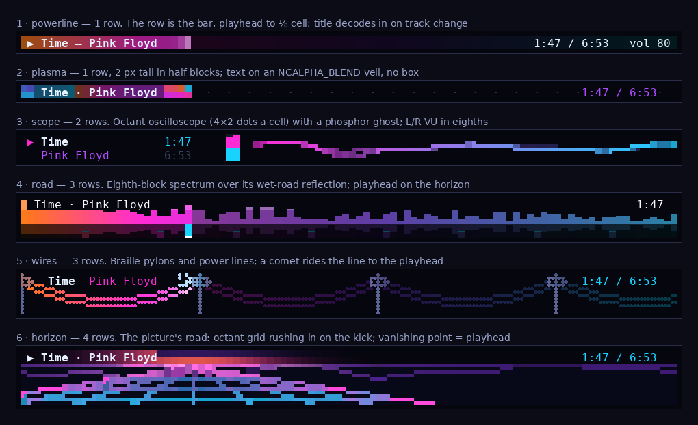
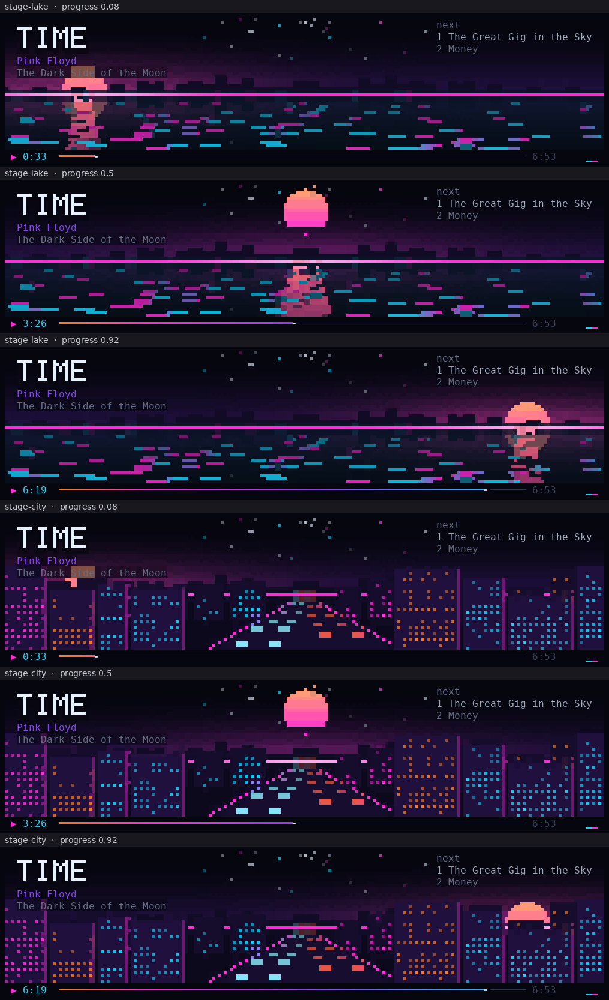

# notmmtui sketches

Six looks for a strip one to four rows tall, before any of it is the
real thing. Each is drawn by Notcurses 3.0.17 (octants on, as under
foot or kitty), dumped cell by cell after every frame, and rasterised.
The audio is made up; nothing talks to the daemon.

`out/notmmtui-sketches.gif` plays a track change (the title decodes in),
playback, then a pause from frame 34: lit parts breathe, the scope
freezes, the spectrum falls.

| | rows | idea | Notcurses doing the work |
|---|---|---|---|
| powerline | 1 | the row is the progress bar; playhead to an eighth of a cell | left-eighth blocks, truecolour per cell |
| plasma | 1 | plasma behind what has played, dots ahead | half blocks (2 px a row); text on an `NCALPHA_BLEND` veil |
| scope | 2 | title/artist, L/R meter, oscilloscope with a ghost | `NCBLIT_4x2` octants; eighth blocks |
| road | 3 | spectrum over its wet-road reflection, falling peaks | eighth blocks, inverted for the reflection |
| wires | 3 | braille pylons and power lines; a comet rides to the playhead | `NCBLIT_BRAILLE` |
| horizon | 4 | the reference's road: a grid rushing in on the beat, vanishing point = playhead | octants, half-block sky |

## The larger view: stage

Nine rows and more: the horizon grown into a scene. Two grounds to choose
from, `stage-lake` and `stage-city`; `out/notmmtui-stage-lake.gif` and
`out/notmmtui-stage-city.gif` are 12×100, and `out/notmmtui-stage-arc.png`
has both at the start of a track, half way and near the end.

- The sun is the playhead on an **arc**: rising at the left as the track
  starts, highest half way, setting at the right at the end. Striped,
  the sky warmer round it when it is low.
- Mountains of the bands, a dark silhouette on the horizon.
- **lake:** the ground is water. The sky and mountains mirrored, darker
  and bluer; the sun's light a broken column under it, wider as it nears
  and following it across; glints drifting in, more as it gets louder.
- **city:** the ground is a city at night with a road through it. Far
  towers on the ground, near ones up from the bottom and into the sky,
  their windows lit by the bands (bass low, treble high) and flickering;
  traffic in two lanes, tail lights going away, head lights coming in.
  The sun rises and sets behind the towers.
- The title big, in a 5×7 font drawn in octants, uppercase, with a dark
  outline so the sun can pass behind it; artist and album under it and
  the next two in the queue at the right, on a dark veil Notcurses blends
  over the scene (`NCALPHA_BLEND`).
- A dashboard on the last row: state, time, a bar in the sky's colours,
  the duration, the L/R meter.
- The words keep their rows at any height; the horizon is below them.

**Chosen: lake**, not switchable. Tall (`out/notmmtui-stage-tall.gif` at
30×120; `out/notmmtui-stage-tall20.png`, `-tall30`, `-tall45` at three
points in a track):

- The title grows with the stage: a font dot is n×n dots, n = rows / 11
  (1 to 4), so a letter is 3n cells by 2n rows.
- Stars in the dark upper sky, twinkling, keeping clear of the words and
  the sun.
- The sun's column on the water stays narrow as the lake gets tall.

    STAGE_P=0.5 python3 run.py 12 100 stage-lake 21 out/set.dump   # at a given progress

## Run

Needs Notcurses ≥ 3.0.17 (`notcurses-core`), Python 3 with Pillow, and
DejaVu Sans Mono.

    cc -std=c11 -Wall -Wextra -O2 sketch.c -o sketch $(pkg-config --cflags --libs notcurses-core) -lm
    cc -shared -fPIC -O2 wcshim.c -o wcshim.so -ldl
    python3 sheet.py            # -> out/

- `sketch <concept> <frames> <dump>` renders into whatever terminal it
  has and writes each frame's cells (glyph, fg, bg, style) to `dump`.
- `run.py` gives it a pty that answers Notcurses' startup queries as
  foot 1.21 would, so octants and truecolour are on without a display.
- `wcshim.so` (LD_PRELOAD) makes octants one column wide on a glibc
  older than Unicode 16; Arch's glibc needs nothing.
- `raster.py` draws block, sextant, octant and braille glyphs as
  geometry; `glyphs.json` is Notcurses' own sextant/octant tables, made
  by `glyphs.py <notcurses source>`.
- `sheet.py` runs them all into one PNG and one GIF.
